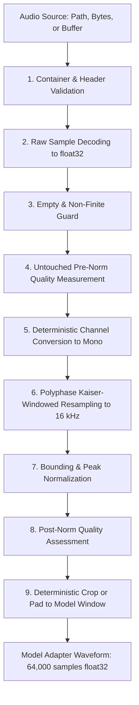

# VoiceShield Audio Processing Contract & Specification

## 1. Overview & Strict Contract Invariants
Every audio input ingested by VoiceShield—whether from a controlled microphone stream, an uploaded file (WAV/FLAC), a WebRTC packet buffer, or a SIP/VoIP RTP stream—is transformed into an identical, deterministic mathematical representation:

- **Sampling Rate ($F_s$)**: Exactly $16,000\text{ Hz}$ (16 kHz).
- **Channels ($C$)**: Exactly 1 (single-channel mono).
- **Data Type**: 32-bit floating point (`numpy.float32`).
- **Amplitude Range**: Strictly bounded to $[-1.0, 1.0]$.
- **Window Length ($L_w$)**: Exactly $64,000\text{ samples}$ ($4.0\text{ seconds}$).
- **Streaming Hop ($L_h$)**: Exactly $16,000\text{ samples}$ ($1.0\text{ second}$).

---

## 2. Step-by-Step Processing Pipeline Order

### Step 1: Container & Header Validation
- Accepts `WAV` (RIFF/WAVE) and `FLAC` (Free Lossless Audio Codec) streams.
- Rejects unsupported compressed audio containers (e.g. raw MP3, AAC) without transparent decoding.
- Enforces channel boundaries ($1 \le C \le 8$).

### Step 2: Raw Sample Decoding
- Decodes integer PCM (`PCM_16`, `PCM_24`, `PCM_32`) or IEEE float containers directly into `float32` sample values without loss of significant bits.

### Step 3: Empty & Non-Finite Integrity Guard
- Rejects zero-byte streams and zero-frame audio files with explicit `EmptyAudioError`.
- Scans decoded samples for `NaN` or `±Inf`. Any non-finite value immediately triggers `InvalidAudioValueError`.

### Step 4: Untouched Pre-Normalization Quality Measurement
Before any mathematical alterations (channel downmixing, filtering, or scaling) occur, physical signal metrics are recorded:
- **Peak Level**: $\max(|x|)$.
- **RMS Energy**: $\sqrt{\frac{1}{N}\sum x_i^2}$.
- **Clipping Fraction**: Ratio of samples where $|x_i| \ge 0.999$. Audio with $> 0.05\%$ clipped samples is flagged as `is_clipped=True`.
- **Silence Check**: Flagged as `is_silent=True` if $\text{RMS} < 10^{-4}$.
- **SNR Estimate**: Ratio between the 95th percentile signal envelope and 10th percentile noise floor in decibels ($20 \log_{10}(P_{95}/P_{10})$).

### Step 5: Deterministic Channel Conversion
Stereo and multi-channel streams are downmixed to mono using deterministic arithmetic mean across channels:
$$x_{\text{mono}}[n] = \frac{1}{C} \sum_{c=1}^C x[n, c]$$
This maintains phase parity and energy balance across stereo microphones without arbitrary channel dropping.

### Step 6: Polyphase Kaiser Resampling to 16,000 Hz
If the original sampling rate $F_s^{\text{orig}} \neq 16000$:
- Rational factors are computed via the greatest common divisor:
  $$\gcd = \gcd(F_s^{\text{orig}}, 16000), \quad \text{up} = \frac{16000}{\gcd}, \quad \text{down} = \frac{F_s^{\text{orig}}}{\gcd}$$
- A Kaiser-windowed FIR lowpass filter ($\beta = 5.0$) is applied via polyphase decomposition (`scipy.signal.resample_poly`), preventing spectral aliasing and high-frequency distortion.
- If $F_s^{\text{orig}} = 16000$, resampling is bypassed as a zero-overhead identity operation.

### Step 7: Bounding & Peak Normalization
- If $\max(|x_{\text{mono}}|) > 1.0$, the entire signal is scaled by $\frac{1.0}{\max(|x_{\text{mono}}|)}$ to prevent digital overflow.
- Hard clamping (`np.clip(..., -1.0, 1.0)`) guarantees that no floating-point rounding artifact exceeds $[-1.0, 1.0]$.

### Step 8: Post-Normalization Quality Assessment
The quality metrics analyzer runs a secondary pass on the normalized 16 kHz mono waveform to populate `metadata.post_norm_quality`.

### Step 9: Deterministic Crop / Pad to Model Adapter Window
The detector requires exactly $64,000\text{ samples}$ ($4.0\text{s}$ at 16 kHz):
- **Short Audio ($N < 64,000$)**: Zero-padded on the right (`pad_mode="right_zero"`) up to 64,000 samples.
- **Long Audio ($N > 64,000$)**: Head-cropped deterministically to the first 64,000 samples for single-window inference, or passed directly to the sliding ring buffer ($4.0\text{s}$ window, $1.0\text{s}$ hop) for streaming analysis.

---

## 3. Explicit Prohibitions in Preprocessing

1. **No Speculative Denoising**: Spectral subtraction, Wiener filtering, and neural denoisers alter spectral phase and remove high-frequency synthetic speech artifacts. Denoising is strictly barred from the core detection path.
2. **No Implicit Silence Trimming**: Silence regions must remain intact so temporal window timestamps correspond exactly to wall-clock recording offsets.
3. **No Random Cropping in Preprocessor**: Windowing must be deterministic across file analysis, streaming inference, and evaluation splits.
4. **No Asymmetric Data Augmentation**: Channel simulations must be applied symmetrically across bona fide and synthetic classes.
