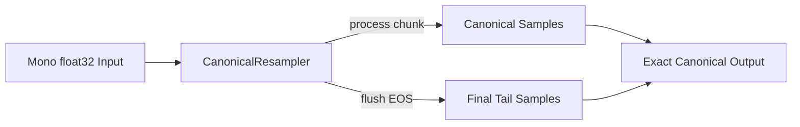
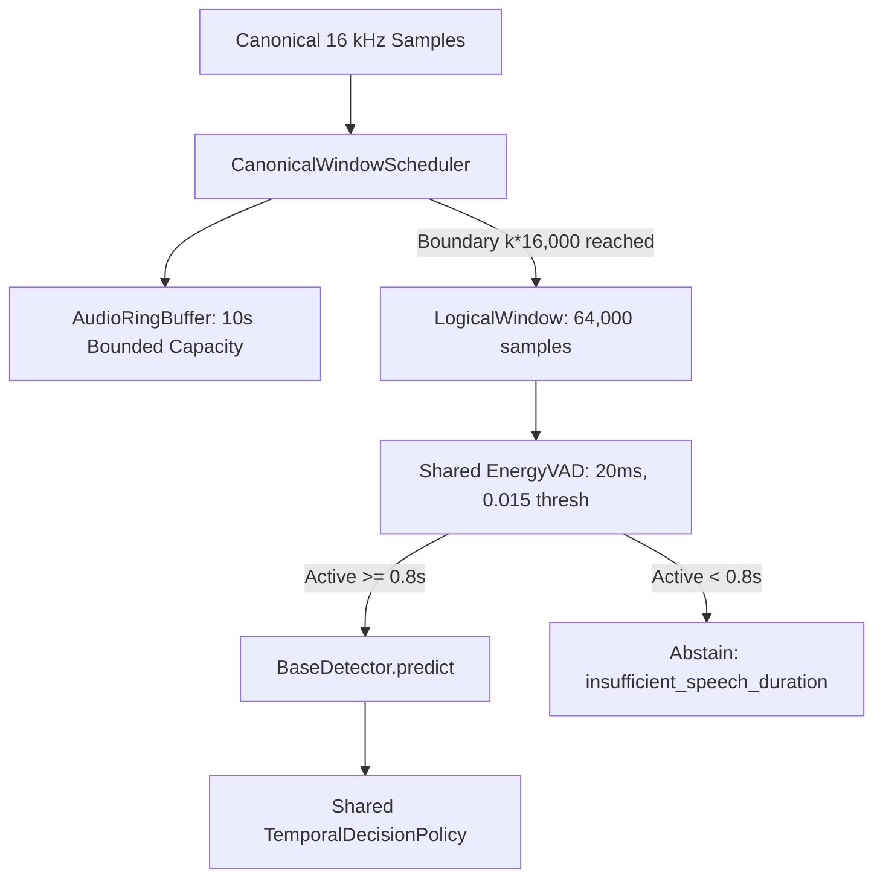

# VoiceShield Audio Processing Contract & Specification

## 1. Overview & Strict Contract Invariants
Every audio input ingested by VoiceShield—whether from an offline audio file (WAV/FLAC) or an online real-time PCM streaming session—is validated and transformed into an identical, deterministic mathematical representation:

- **Source Sampling Rate**: Strictly between $8,000\text{ Hz}$ and $192,000\text{ Hz}$ inclusive ($8,000 \le F_s^{\text{orig}} \le 192,000$). Rates below 8,000 Hz or above 192,000 Hz are rejected with `UnsupportedAudioError`.
- **Canonical Model Sampling Rate ($F_s$)**: Exactly $16,000\text{ Hz}$ (16 kHz).
- **Channels ($C$)**: Exactly 1 (single-channel mono). Multi-channel streams ($C \in \{1, 2\}$ for streaming; $1 \le C \le 8$ for offline files) are deterministically downmixed via arithmetic mean across channels in `float32`.
- **Data Type**: 32-bit floating point contiguous array (`numpy.float32`).
- **Strict Amplitude Domain**: Strictly bounded to $[-1.0, 1.0]$. Decoded floating-point samples outside $[-1.0, 1.0]$ or non-finite values (`NaN`, `±Inf`) are strictly rejected with `InvalidAudioValueError` prior to resampling. PCM integer WAV/FLAC decoded into the normal $[-1.0, 1.0]$ domain remains supported. Silent whole-file peak normalization is barred from the canonical parity path.
- **Window Length ($L_w$)**: Exactly $64,000\text{ samples}$ ($4.0\text{ seconds}$).
- **Window Hop ($L_h$)**: Exactly $16,000\text{ samples}$ ($1.0\text{ second}$).
- **Engineering Parity Scope**: Architectural and numerical parity guarantees that offline file evaluation and real-time streaming produce identical canonical samples, window boundaries, VAD decisions, detector inputs, and temporal policy states. Engineering parity does **not** validate detector accuracy, calibrate scores, prove cross-dataset generalization, or demonstrate production readiness.

---

## 2. Canonical Stateful Resampler (`CanonicalResampler`)

Offline file evaluation and real-time streaming use the single `CanonicalResampler` implementation (`voiceshield.dsp.resampler.CanonicalResampler`), replacing legacy separate scipy and streaming polyphase sinc implementations.

### 1. Algorithm & Bounded State
- **Algorithm**: Bandlimited sinc interpolation using a precomputed polyphase Kaiser/sinc kernel.
- **Bounded FIR History**: Bounded memory buffer ($O(1)$ with respect to stream length). The resampler retains only the unconsumed filter history needed for FIR convolution continuity across chunk boundaries; it never buffers the full audio stream and does not use $O(N^2)$ repeated batch-resampling workarounds.
- **16 kHz Identity**: When $F_s^{\text{orig}} = 16,000\text{ Hz}$, resampling executes as an exact identity operation: input samples are passed through directly with zero phase alteration, no filter delay, and an empty flush tail.

### 2. Exact Output-Length Rule
Across all `process(chunk)` calls and final `flush()`, the total output sample count strictly satisfies:
$$\text{total\_canonical\_samples} = \left\lceil \frac{\text{total\_source\_frames} \times 16000}{F_s^{\text{orig}}} \right\rceil$$

For exact integer-duration inputs:
- An exact $4.0\text{s}$ source at any supported rate produces exactly $64,000\text{ samples}$.
- An exact $5.0\text{s}$ source at any supported rate produces exactly $80,000\text{ samples}$.

### 3. Explicit Lifecycle
- `process(chunk) -> np.ndarray[float32]`: Ingests an arbitrary chunk, emits all completed convolution strides, and retains unconsumed tail history in the bounded buffer.
- `flush() -> np.ndarray[float32]`: Emits all valid FIR tail samples required to meet the exact expected canonical output length. Flush is idempotent: a second flush returns an empty array. Calling `process()` after `flush()` raises `RuntimeError` until `reset()`.
- `reset() -> None`: Clears all buffer history and frame counters for clean stream reuse.

### 4. Numerical Parity Tolerance
Output samples across arbitrary chunking patterns (single batch, 20 ms frames, 1.0s frames, seeded irregular partitions, and rational-boundary crossing partitions) match the canonical batch output within a documented tolerance:
$$\max |y_{\text{chunked}} - y_{\text{batch}}| \le 1.0 \times 10^{-5}$$

---

## 3. Shared Canonical Window Scheduler (`CanonicalWindowScheduler`)

Both offline and streaming pipelines employ the shared `CanonicalWindowScheduler` (`voiceshield.dsp.scheduler.CanonicalWindowScheduler`):

### 1. Exact Canonical Hop Grid
Windows are emitted strictly along the sample grid:
- **Window 0**: samples $[0, 64000)$, timestamps $[0.0\text{s}, 4.0\text{s})$
- **Window 1**: samples $[16000, 80000)$, timestamps $[1.0\text{s}, 5.0\text{s})$
- **Window $k$**: samples $[k \times 16000, k \times 16000 + 64000)$, timestamps $[k \times 1.0\text{s}, k \times 1.0\text{s} + 4.0\text{s})$

### 2. Full-Window-Only & End-of-Stream Tail Policy
- Model inference and temporal decision evaluation require an exact, contiguous $64,000$-sample full window.
- **No Partial / Padded Model Windows**: The pipeline never manufactures a padded or cyclically looped window from less than $4.0\text{s}$ of audio.
- **Insufficient Contiguous Audio**: Any file or finalized stream with fewer than $64,000$ canonical contiguous samples skips inference, returns null scores, and reports status `insufficient_evidence` with reason `insufficient_contiguous_audio`.
- **No Trailing Non-Hop Windows**: Non-hop-aligned or trailing padded windows after full windows are prohibited. Boundary durations behave deterministically:
  - $3.99\text{s}$: 0 windows; `insufficient_contiguous_audio`.
  - $4.00\text{s}$: window $[0.0, 4.0]$.
  - $4.01\text{s}$: window $[0.0, 4.0]$ only.
  - $4.99\text{s}$: window $[0.0, 4.0]$ only.
  - $5.00\text{s}$: windows $[0.0, 4.0]$ and $[1.0, 5.0]$.
  - $5.01\text{s}$: windows $[0.0, 4.0]$ and $[1.0, 5.0]$.

### 3. Decoupled Inference Backpressure
- Logical window scheduling is completely decoupled from worker backpressure.
- Offline file evaluation synchronously evaluates every emitted logical window without dropping.
- Real-time streaming employs bounded backpressure (at most 1 in-flight inference and 1 pending window); when backpressure forces window replacement, drops are explicitly counted (`total_windows_dropped`).

---

## 4. Shared Voice Activity Detection (EnergyVAD)

Offline and streaming pipelines share the identical `EnergyVAD` implementation (`voiceshield.streaming.vad.EnergyVAD`):
- **Subframe Duration**: Exactly $20\text{ ms}$ ($320\text{ samples}$ at 16 kHz).
- **Energy Threshold**: $\text{RMS} \ge 0.015$.
- **Speech Duration Threshold**: Minimum $0.8\text{ seconds}$ active speech per $4.0\text{s}$ window.
- **Leftover Subframes**: Tail samples shorter than $20\text{ ms}$ are evaluated on their own partial RMS energy.
- **Gating**: Windows with speech duration $< 0.8\text{s}$ skip detector inference, return null scores, set state to `insufficient_evidence`, set reason to `insufficient_speech_duration`, and are excluded from score smoothing and elevation history.

---

## 5. Shared Temporal Decision Policy (TemporalDecisionPolicy)

Both paths run the identical `TemporalDecisionPolicy` (`voiceshield.streaming.policy.TemporalDecisionPolicy`):
- **Smoothing**: EWMA ($\alpha = 0.7$) or median filtering over recent eligible synthetic scores.
- **Elevation**: $N$-of-$M$ elevation (default: 2 of 3 windows $\ge 0.65$) to reach `HIGH`.
- **Hysteresis**: Requires consecutive scores $\le 0.45$ to clear anomaly from `HIGH` to `LOW`.
- **File-Level Decision**: In offline evaluation, `is_synthetic_suspected` is derived strictly from `policy.current_state == DecisionState.HIGH`. Custom count or consecutive-window heuristics are removed.
- **Request Thresholds**: Request-level threshold overrides construct an effective copy of `TemporalPolicyConfig` without mutating shared objects.
