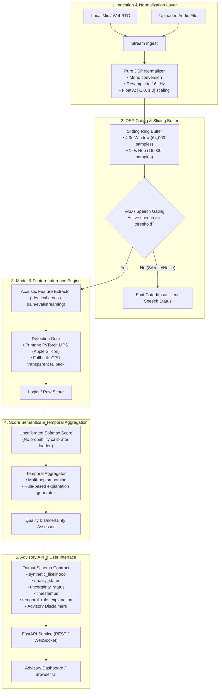

# VoiceShield — Historical Implementation & Architecture Plan

> **Status:** This document records the target architecture and unfinished
> milestones; it is not the v0.1.1 as-built contract. Current outputs are
> uncalibrated acoustic anomaly scores. Use the README, model card, evaluation
> card, and release notes for supported behavior and evidence.

## 1. MVP Scope and Explicit Non-Goals

### 1.1 MVP Scope
VoiceShield is an audio machine learning system designed to analyze voice streams and detect synthetic speech, voice cloning, and voice conversion (VC).

- **Audio Input Contract**: Single-channel (mono), 16,000 Hz, 32-bit floating-point samples normalized to the range $[-1.0, 1.0]$.
- **Temporal Framing**:
  - Model window duration: Exactly 4.0 seconds (64,000 samples at 16 kHz).
  - Streaming hop interval: 1.0 second (16,000 samples at 16 kHz).
  - Pre-inference gating: Configurable minimum accumulated active speech (energy/VAD threshold) required within the 4.0s window before inference is executed.
- **Inference Output Contract**:
  - `synthetic_likelihood`: Bounded, uncalibrated softmax score in $[0.0, 1.0]$; not a probability.
  - `quality_status`: Input health metrics (sample rate validation, peak amplitude, clipping detection, signal-to-noise ratio estimate).
  - `uncertainty_status`: Uncertainty flag reflecting out-of-distribution characteristics, insufficient speech energy, or marginal window coverage.
  - `timestamps`: Sample indices and relative/wall-clock time offsets for the analyzed window.
  - `temporal_rule_explanation`: Human-interpretable rationale explaining multi-hop temporal aggregation decisions (e.g., sustained high confidence over consecutive hops vs. isolated transient anomalies).
- **Supported Ingestion Sources**:
  - Controlled local microphone capture (via Web Audio API or local soundcard stream).
  - Audio file uploads (WAV, FLAC, OGG, MP3 through normalized decoding).
  - Controlled WebRTC / VoIP media stream endpoints (explicitly routed audio streams).
- **Decision & Safety Policy**:
  - All outputs are strictly advisory. The system displays contextual warnings and prompts the user to perform independent verification (e.g., callback on a known authentic number, out-of-band verification).
  - The system never terminates or blocks calls automatically.

### 1.2 Explicit Non-Goals & Product Boundaries
- **No Identity Proof**: A "bona fide" classification means the audio does not exhibit synthetic speech artifacts; it **does not** verify that the caller is who they claim to be.
- **No Fraud Assessment**: Synthetic detection score is strictly an acoustic attribute, not a probability of financial fraud or deceptive intent.
- **No Arbitrary Cellular Call Capture**: In a web browser environment, security sandboxing strictly restricts media capture to user-permitted microphone inputs (`navigator.mediaDevices.getUserMedia`) or explicitly shared system audio tabs. Browsers cannot intercept baseband cellular phone calls or third-party phone dialer audio on a mobile device or Mac. Any telephone/SIP analysis requires an explicit PBX, WebRTC gateway, or VoIP loopback pipeline.
- **No Automatic Call Dropping/Blocking**: VoiceShield provides observability and advisory warnings only.
- **No Speculative Denoising in Core Path**: Denoising filters can distort spectral phase and high-frequency harmonics, destroying synthetic cues. No denoising stage will be introduced into the primary detector pipeline without empirical ablation testing.

---

## 2. Component Diagram



---

## 3. Proposed Repository Structure

```
voiceshield/
├── pyproject.toml              # Dependencies, build metadata, tool configs (ruff, pytest, mypy)
├── uv.lock                     # Deterministic, pinned package lockfile
├── README.md                   # Project overview, setup guide, and usage instructions
├── docs/
│   ├── implementation_plan.md  # Architectural roadmap, risks, milestones
│   ├── contracts.md            # DSP and JSON API schema definitions
│   └── setup_macos.md          # macOS Apple Silicon / M3 specific environment guide
├── voiceshield/
│   ├── __init__.py
│   ├── core/                   # Core types, domain schemas, error classes
│   │   ├── __init__.py
│   │   ├── types.py            # AudioChunk, IngestMetadata, QualityStatus
│   │   └── schema.py           # DetectionResult, TemporalExplanation, OutputContract
│   ├── dsp/                    # Pure DSP layer (no framework dependencies)
│   │   ├── __init__.py
│   │   ├── normalizer.py       # Mono conversion, 16 kHz resample, [-1, 1] scaling
│   │   ├── vad.py              # Energy and speech activity gating
│   │   ├── buffer.py           # Sliding ring buffer (4.0s window, 1.0s hop)
│   │   └── quality.py          # Clipping detection, SNR, silence ratio
│   ├── models/                 # Pure model logic and PyTorch inference
│   │   ├── __init__.py
│   │   ├── base.py             # Abstract BaseDetector interface
│   │   ├── architecture.py     # Lightweight acoustic deepfake classifier
│   │   ├── device.py           # MPS device selector with graceful CPU fallback
│   │   └── calibrator.py       # Platt / Temperature scaling probability calibrator
│   ├── pipeline/               # Aggregation & temporal reasoning
│   │   ├── __init__.py
│   │   ├── temporal.py         # Temporal rule engine (consecutive hop tracker, decay)
│   │   └── stream_engine.py    # End-to-end streaming detection coordinator
│   └── api/                    # Service layer (separated from DSP/model core)
│       ├── __init__.py
│       ├── server.py           # FastAPI application (REST & WebSocket)
│       └── routes/
│           ├── __init__.py
│           ├── analyze_file.py # File upload endpoint
│           └── stream_ws.py    # Real-time WebSocket streaming endpoint
├── ui/                         # Lightweight browser interface
│   ├── index.html              # Modern, high-clarity advisory dashboard
│   ├── app.js                  # Web Audio API 16 kHz streaming client
│   └── styles.css              # Styling (clean dark mode, advisory warning badges)
└── tests/
    ├── __init__.py
    ├── conftest.py             # Shared fixtures (synthetic sine, silence, mock streams)
    ├── test_dsp_normalizer.py  # Validation of 16 kHz, float32, [-1, 1] contract
    ├── test_sliding_buffer.py  # Window (4.0s) and hop (1.0s) invariants
    ├── test_vad_gating.py      # Speech gating thresholds
    ├── test_device_fallback.py # MPS availability and deterministic CPU fallback
    ├── test_temporal_rules.py  # Temporal explanations and multi-hop smoothing
    └── test_api_schema.py      # Output schema compliance and advisory disclaimers
```

---

## 4. Required vs. Optional Dependencies

### 4.1 Required Dependencies (Runtime Core)
- **`python = ">=3.11,<3.13"`**: Core interpreter (using Homebrew Python 3.11).
- **`numpy >= 1.26.0, < 2.3.0`**: Float32 numerical array operations and sliding ring buffers.
- **`scipy >= 1.13.0`**: High-fidelity band-limited signal resampling and filter operations.
- **`torch >= 2.2.0`**: Neural network inference with native Apple Silicon `mps` acceleration.
- **`torchaudio >= 2.2.0`**: Feature extraction (Spectrogram/Log-Mel/LFCC).
- **`soundfile >= 0.12.1`**: Reading and writing uncompressed and compressed WAV/FLAC files via system `libsndfile`.
- **`pydantic >= 2.6.0`**: Strict schema validation and JSON serialization for output contract.

### 4.2 Required Dependencies (Development & Quality Assurance)
- **`pytest >= 8.0.0`**: Unit and integration test runner.
- **`pytest-asyncio >= 0.23.0`**: Async endpoint test harness.
- **`ruff >= 0.3.0`**: High-performance linter and code formatter.
- **`mypy >= 1.9.0`**: Static type checker for strict type annotation compliance.

### 4.3 Optional / Staged Dependencies
- **`fastapi >= 0.110.0` & `uvicorn >= 0.28.0`**: REST and WebSocket streaming server (Phase 5).
- **`webrtcvad >= 2.0.10` or `silero-vad`**: Production-grade neural speech activity detection if energy-based VAD is insufficient.
- **`ffmpeg-python`**: Transcoding multi-format audio files to raw 16 kHz PCM (leveraging installed system `/opt/homebrew/bin/ffmpeg`).

---

## 5. Project Risks and Mitigation Strategies

| Risk Area | Specific Failure Mode | Mitigation Strategy |
| :--- | :--- | :--- |
| **Data Leakage** | Optimistic validation metrics caused by identical speakers, utterances, or generator families appearing in both train and validation/test splits. | Enforce strict split disjointness across: (1) speaker identity, (2) source prompt/transcript, (3) synthesis model family (e.g., ElevenLabs vs. VITS), and (4) recording channel condition. Never touch the final test set for threshold calibration. |
| **Unseen Generators** | Overfitting to artifacts of specific vocoders (e.g., HiFi-GAN periodic artifacts) resulting in poor zero-shot performance against new diffusion or autoregressive models. | Train on diverse vocoder paradigms; augment representations with phase and raw waveform features; evaluate on strictly unseen generator held-out benchmarks. |
| **Codec Robustness** | Telephony compression codecs (G.711 $\mu$-law/A-law, AMR-WB, Opus) strip high frequencies and introduce quantization noise, mimicking or masking synthetic voice artifacts. | Apply telephone and VoIP codec simulations symmetrically to **both** bona fide and synthetic audio during training and evaluation; verify detector robustness under diverse bitrates. |
| **Browser Limits** | Inability to intercept native cellular or third-party dialer streams directly from a web page due to OS security sandboxing. | Explicitly document browser microphone boundaries. The browser captures controlled mic audio only; telephonic streaming requires server-side SIP/WebRTC termination. |
| **Privacy & Biometrics** | Handling sensitive personal voice recordings in violation of data retention laws. | Maintain zero persistent audio storage by default in streaming inference. Process audio in memory via ephemeral buffers and immediately discard raw samples unless explicit consent is logged. |
| **Score Calibration** | Raw model logits produce overly extreme confidence values that misrepresent actual empirical probabilities. | Implement temperature scaling or isotonic regression calibrated exclusively on a designated validation split. Output calibrated likelihood alongside uncertainty flags. |

---

## 6. Staged Milestones and Acceptance Criteria

### Milestone 1: Environment & DSP Core Contract
- **Deliverables**: Repository initialization, `pyproject.toml`, pinned virtual environment via `uv`, pure DSP module (`normalizer.py`, `buffer.py`).
- **Acceptance Criteria**:
  - All unit tests pass verifying input conversion to mono, 16,000 Hz, `float32`, $[-1.0, 1.0]$.
  - Sliding ring buffer strictly yields 64,000 samples (4.0s) every 16,000 samples (1.0s hop).
  - Code passes `ruff check`, `ruff format --check`, and `mypy`.

### Milestone 2: Speech Gating & Input Quality Validation
- **Deliverables**: VAD / energy-based gating module, quality metrics analyzer (`quality.py`).
- **Acceptance Criteria**:
  - Windows with active speech duration below threshold are cleanly flagged and bypass heavy inference.
  - Clipping, extreme silence, or severe SNR degradations produce accurate `quality_status` alerts without raising unhandled exceptions.

### Milestone 3: Model Inference & Hardware Fallback Engine
- **Deliverables**: `BaseDetector` interface, reference deepfake classification model, device manager with Apple Silicon MPS acceleration and CPU fallback.
- **Acceptance Criteria**:
  - Model runs on MPS when available; transparently falls back to CPU if an unsupported operator or environment variable requires it.
  - Output produces reproducible scores for identical input seeds.
  - Execution time per 4.0s window is under 200 ms on Apple M3.

### Milestone 4: Temporal Aggregation & Explanation Logic
- **Deliverables**: Multi-hop temporal smoothing engine (`temporal.py`), human-readable explanation generator.
- **Acceptance Criteria**:
  - Transient 1-second anomalies do not trigger premature alerts without sustained corroboration.
  - Detailed `temporal_rule_explanation` generated for all outputs, stating reasons for score shifts.

### Milestone 5: Advisory API & Controlled Browser Demo
- **Deliverables**: FastAPI REST/WebSocket server, lightweight Web Audio browser UI.
- **Acceptance Criteria**:
  - Live microphone audio streams into WebSocket at 16 kHz and receives continuous window analysis.
  - UI displays advisory warning banners, an uncalibrated anomaly score, and explicit disclaimers (not identity proof, not fraud probability).

### Milestone 6: Robustness Benchmarking & Calibration
- **Deliverables**: Evaluation pipeline with codec augmentation (Opus, G.711) and temperature calibration on dev set.
- **Acceptance Criteria**:
  - Calibrated Brier score and Expected Calibration Error (ECE) documented on dev split.
  - Final test set evaluated exactly once with frozen weights and thresholds.

---

## 7. Storage and Compute Considerations

- **Unified Memory (8 GB Limit)**: The development machine features 8 GB of unified memory. High-capacity foundation models (e.g., multi-gigabyte SSL models like Wav2Vec 2.0 XL) risk memory pressure or out-of-memory paging on M3. The primary detector architecture will target lightweight acoustic backbones (e.g., LFCC-LCNN, RawNet2, or distilled Conformer backbones with $< 30\text{M}$ parameters) to keep memory footprint under 1.5 GB during inference.
- **Inference Latency**: Streaming hop is 1.0s. Inference on a 4.0s chunk must comfortably complete in $< 200\text{ms}$ on M3 MPS/CPU to prevent queue backlog in streaming mode.
- **Disk Budget**: The system has $\approx 206\text{ GB}$ available disk space. Model checkpoints and test fixtures must remain compact ($< 500\text{ MB}$ total), with raw audio datasets managed in isolated directories outside version control.
