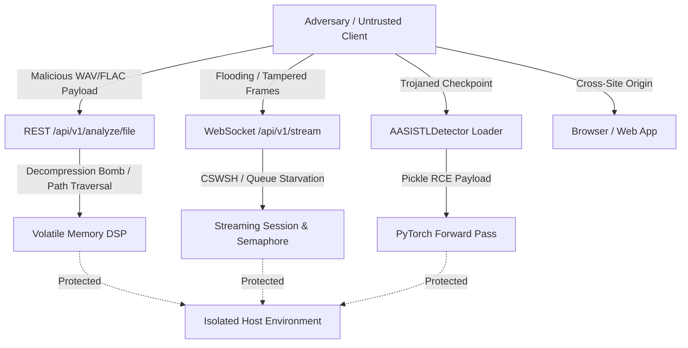

# VoiceShield Security, Privacy, and Threat Model Specification

**Classification**: Advisory Architecture Specification  
**Version**: `0.1.0`  
**Scope**: VoiceShield Core DSP Engine, Streaming Session Core, FastAPI Services, and Web Microphone Dashboard  
**Date**: October 2026  

---

## 1. Executive Summary & Core Principles

VoiceShield is designed as an **advisory acoustic deepfake detection engine**. Because synthetic voice technologies and acoustic monitoring inherently intersect with user privacy, sensitive biometric data, and adversarial threats, VoiceShield operates under four foundational principles:

1. **Volatile-Only Processing**: Voice recordings, raw PCM samples, and floating-point audio buffers are processed exclusively in volatile RAM and **never written to persistent disk storage** or logged.
2. **Defensive Model Isolation**: Untrusted checkpoints are protected by cryptographic SHA-256 integrity verification and restricted PyTorch deserialization (`weights_only=True`).
3. **Strict Resource Bounding**: Audio decompression, sliding-window queuing, WebSocket frame ingestion, and subprocess executions are bounded by hard ceilings to prevent Denial of Service (DoS) and memory exhaustion attacks.
4. **Transparent Advisory Scope**: VoiceShield explicitly states that acoustic anomaly scores do **not** prove caller identity, do **not** constitute legal proof of fraud, and do **not** guarantee 100% detection accuracy.

---

## 2. Threat Model

### 2.1 Assets to Protect

| Asset | Sensitivity | Protection Goal |
| :--- | :---: | :--- |
| **Host System & OS** | Critical | Prevent Remote Code Execution (RCE), command injection, and host compromise. |
| **System Resources (RAM/CPU/MPS)** | High | Prevent memory exhaustion, decompression bombs, and inference queue starvation. |
| **User Voice & Acoustic Privacy** | High | Guarantee zero unauthorized retention, zero voiceprint creation, and zero audio logging. |
| **Model Weight Integrity** | High | Prevent weight tampering, trojaned models, or unverified weight substitution. |
| **Advisory Decision Integrity** | Medium | Prevent cross-site WebSocket hijacking (CSWSH) and spoofed stream sessions. |

### 2.2 Threat Actors & Vectors



1. **Malicious Audio Uploaders**: Submitting crafted audio files containing path traversal sequences, decompression bombs (huge uncompressed durations), corrupt headers, or infinite values (NaN/Inf) to crash the server or exhaust unified memory.
2. **Adversarial Streaming Clients**: Establishing excessive WebSocket connections, sending oversized frames (> 128 KB), refusing to send data (idle connection starvation), or flooding the audio pipeline to create unbounded inference backlogs.
3. **Malicious / Compromised Weight Suppliers**: Distributing backdoored `.pth` checkpoints containing malicious Python pickle bytecode executing arbitrary commands upon `torch.load`.
4. **Cross-Site Attackers (CSWSH & CORS)**: Exploiting browser-based WebSocket connections from unauthorized third-party origins to hijack microphone sessions or extract anomaly evaluations.
5. **Adversarial Synthesizers**: Attackers crafting adversarial perturbations or novel generative architectures designed to evade AASIST-L acoustic feature representations.

---

## 3. Implemented Security & Privacy Controls

### 3.1 Unsafe Deserialization & Checkpoint Verification (CWE-502)

- **Control**: `torch.load(self.checkpoint_path, map_location="cpu", weights_only=True)`
- **Mechanism**: VoiceShield enforces `weights_only=True` on all PyTorch weight loading operations in `src/voiceshield/models/aasist_adapter.py`. This restricts the unpickler to tensors and primitive collections, completely neutralizing arbitrary Python code execution payloads embedded in malicious checkpoints.
- **Integrity Pinning**: VoiceShield supports `expected_sha256` parameter and the `VOICESHIELD_EXPECTED_SHA256` environment variable. When present, the weights file is hashed via streaming SHA-256 (`_verify_checkpoint_sha256`) and verified *before* loading. Any mismatch triggers an immediate hard failure (`ValueError`).

### 3.2 Audio Decompression & Memory Bomb Prevention (CWE-400)

- **Control**: Header inspection and bounded sample reading in `load_audio()`.
- **Mechanism**: In `src/voiceshield/dsp/preprocessor.py`:
  1. **Sampling Rate Boundaries**: Input sample rates are checked against `8000 <= orig_sr <= 192000`. Astronomical or non-positive rates are rejected immediately.
  2. **Header Duration Pre-Check**: Before allocating sample arrays, `sfile.frames / orig_sr` is calculated. If the declared duration exceeds `max_duration_seconds` (e.g. 300.0s for uploads), the file is rejected with `UnsupportedAudioError` before decoding samples into RAM.
  3. **Bounded Reading**: During decoding, `sfile.read()` reads at most `int(orig_sr * (max_duration_seconds + 1.0))` frames. This prevents crafted compressed files (e.g., FLAC zip-bombs) from consuming hundreds of megabytes of RAM.

### 3.3 FFmpeg Subprocess Elimination & Libsndfile Safety

- **Architectural Decision**: VoiceShield **does not invoke FFmpeg via subprocess**.
- **Rationale**:
  - Eliminating `subprocess.run(["ffmpeg", ...])` removes entire classes of command-injection, shell-expansion, argument-injection, and zombie-subprocess vulnerabilities.
  - Audio decoding is performed strictly in-process using `libsndfile` via Python `soundfile` bindings.
  - Allowed container formats are locked to `("WAV", "FLAC")`. All other container formats (e.g. MP4, AVI, MKV, OGG) are rejected at the header boundary.

### 3.4 Subprocess Execution Hardening (CWE-78, CWE-400)

- **Control**: Strict argument arrays, `shell=False`, and mandatory execution timeouts.
- **Mechanism**: In `src/voiceshield/reproducibility/metadata.py` and `src/voiceshield/benchmark/runner.py`, system queries (`git rev-parse`, `git status`, `sysctl -n`) are strictly executed with:
  - Fixed argument lists (`subprocess.run(["sysctl", "-n", key], ...)`).
  - Explicit timeouts: `timeout=5.0`.
  - Suppressed shell execution (`shell=False`).
  - No user-controlled parameters passed to shell executables.

### 3.5 Path Traversal & Filename Sanitization (CWE-22)

- **Control**: URL-decoding, control character removal, and basename restriction.
- **Mechanism**: In `services/api/routes/analyze_file.py::sanitize_filename()`:
  1. `urllib.parse.unquote()` is executed first to prevent double-encoding bypasses (e.g., `%2e%2e%2f` -> `../`).
  2. Null bytes (`\x00`) and ASCII control characters (`\x01-\x1f\x7f-\x9f`, newlines, carriage returns) are stripped.
  3. Windows backslashes are normalized to forward slashes.
  4. Path traversal sequences (`..`) and directory hierarchies are stripped via `Path.name` and regex scrubbing.
  5. Fallback defaults to `uploaded_audio.wav` if the resulting filename is empty.

### 3.6 WebSocket Streaming Security & Session Lifecycle

- **Origin Verification**: Every incoming WebSocket connection checks the HTTP `Origin` header against `VOICESHIELD_CORS_ORIGINS`. Disallowed cross-site origins are rejected before handshake acceptance (`WS_1008_POLICY_VIOLATION`).
- **Connection Concurrency**: Maximum concurrent streaming sessions are guarded by `VOICESHIELD_MAX_CONCURRENT_SESSIONS` (default: 10). Excess sessions receive a structured `CONCURRENCY_LIMIT_REACHED` error.
- **Frame Size Ceiling**: Streaming audio frames are capped at `MAX_FRAME_BYTES_DEFAULT` (128 KB = 131,072 bytes). Client handshake metadata cannot increase this ceiling. Frames exceeding this limit trigger immediate closure with `WS_1009_MESSAGE_TOO_BIG`.
- **Idle Timeout**: Inactive connections exceeding 30.0 seconds of silence/no-traffic are disconnected cleanly (`WS_1000_NORMAL_CLOSURE`).
- **Deterministic Cleanup**: Session teardown (`finally:` block) guarantees cancellation of in-flight inference tasks, circular buffer memory reset (`session.reset()`), and removal from active session registries.

### 3.7 Inference Denial of Service (DoS) & Queue Starvation

- **Worker Concurrency Guard**: A process-wide `asyncio.Semaphore(1)` ensures that at most one model forward pass is executed at any moment, preventing unified memory thrashing and Out-Of-Memory (OOM) crashes on Apple Silicon M3 hardware.
- **Bounded Streaming Queue Depth**: The streaming session enforces an O(1) bounded queue:
  - At most **one** window is in flight for model inference.
  - At most **one** fresher eligible window is held in the pending slot (`_pending_window`).
  - If a newer window arrives while inference is in flight, it **replaces** the older pending window rather than growing an unbounded queue.

### 3.8 Zero-Persistence Audio Privacy Policy

- **No Disk Storage**: Raw PCM audio bytes received over REST or WebSocket are buffered strictly in volatile memory (`io.BytesIO` or `AudioRingBuffer`).
- **No Residual Logging**: Log messages across `services/api/` and `src/voiceshield/` record only session IDs, sampling rates, window counts, and timing statistics. **No audio samples, transcripts, spoken words, or personally identifiable data are ever logged.**
- **Automatic Browser Cleanup**: The React dashboard uses `AudioWorklet` with zero browser-side caching or IndexedDB storage. Upon stopping or unmounting, all tracks on `MediaStream` are explicitly stopped (`track.stop()`), and `AudioContext` and `WebSocket` connections are closed.

### 3.9 CORS Configuration Hardening

- **Control**: Automatic credential restriction on wildcard origin.
- **Mechanism**: In `services/api/main.py`, if `VOICESHIELD_CORS_ORIGINS` contains `*`, `allow_credentials` is automatically set to `False` to prevent browser CORS violations and credential leakage risks.

---

## 4. Residual Risks

Despite the defensive controls implemented above, the following residual risks remain outside the software's direct architectural control:

1. **Adversarial Acoustic Perturbations**: Deepfake generators can introduce imperceptible high-frequency noise or vocoder artifacts designed to evade the AASIST-L graph architecture. VoiceShield outputs must always be interpreted as advisory evidence, not proof.
2. **Local Machine & Kernel Compromise**: If the host machine running VoiceShield is compromised at the root or operating system level, memory scraping could access volatile audio buffers while inference is running. Host hardening (FileVault, SIP, sandboxing) is required.
3. **Physical Microphone Eavesdropping**: The browser dashboard relies on the operating system's microphone privacy indicators. If the host machine has malicious hardware or driver-level keyloggers/wiretaps, audio could be intercepted before reaching the browser.
4. **Zero-Day Acoustic Generators**: AASIST-L was trained on known generator families. Unseen, novel neural voice synthesis methods may exhibit higher false-negative rates until the detector is retrained or updated.

---

## 5. Incident Response & Rollback Procedures

### 5.1 Incident Response Plan

In the event of a suspected security vulnerability, unexpected data exposure, or model integrity failure:

1. **Immediate Service Isolation**:
   ```bash
   # Terminate active API servers
   pkill -f "uvicorn services.api.main:app"
   ```
2. **Audit Checkpoint Integrity**:
   Verify the SHA-256 hash of the on-disk weights file:
   ```bash
   shasum -a 256 models/weights/AASIST-L.pth
   ```
   Compare against the published upstream Clova AI / HuggingFace hash.
3. **Inspect Active Origin Policy**:
   Verify that `VOICESHIELD_CORS_ORIGINS` is not set to `*` in production environments.
4. **Rotate Infrastructure Credentials**:
   If deployed behind a reverse proxy (e.g. Nginx, Caddy), rotate SSL/TLS certificates and API tokens.

### 5.2 Rollback Procedure

If a deployed update or checkpoint exhibits behavioral instability or regression:

1. **Revert to Previous Git Release**:
   ```bash
   git checkout tags/v0.1.0-stable
   ```
2. **Re-run Security Parity Suite**:
   ```bash
   .venv/bin/pytest tests/test_security_privacy.py -v
   ```
3. **Restart Service in Safe Mode**:
   ```bash
   VOICESHIELD_DEVICE=cpu VOICESHIELD_EXPECTED_SHA256=<KNOWN_HASH> make api
   ```

---

## 6. Legal, Regulatory, and Compliance Review Notice

> [!WARNING]
> **Legal Disclaimer & Review Requirement**  
> VoiceShield and this document **do not constitute legal advice** and do **not certify compliance** with any municipal, state, federal, or international wiretapping, biometric privacy, or artificial intelligence regulations.  
> Deploying synthetic voice detection technologies in production requires independent formal review by qualified legal counsel.

Organizations deploying VoiceShield must obtain legal review regarding:

1. **Wiretapping and Recording Consent**:
   - In jurisdictions requiring **all-party consent** (e.g., California, Florida, Massachusetts, Germany), capturing or routing live telephone or microphone audio through automated analysis tools may require explicit affirmative consent from all speakers.
   - VoiceShield provides visual and audible consent status banners in the UI, but technical indicators do not replace legal consent workflows.
2. **Biometric Privacy Laws**:
   - Statutes such as the **Illinois Biometric Information Privacy Act (BIPA)**, **Texas Capture or Use of Biometric Identifier Act (CUBI)**, and **California Consumer Privacy Act / CPRA** govern the collection of voiceprints.
   - While VoiceShield extracts acoustic spectral/graph anomaly representations rather than biometric identification voiceprints, legal definitions of "biometric identifier" vary by jurisdiction.
3. **General Data Protection Regulation (GDPR) / UK GDPR**:
   - Processing human voice recordings may constitute personal data under Article 4(1) and special category biometric data under Article 9. Deployers must establish an appropriate Article 6 lawful basis and maintain Data Protection Impact Assessments (DPIA).
4. **AI Safety and Synthetic Media Disclosures**:
   - The **EU Artificial Intelligence Act (EU AI Act)** and US Federal Executive Orders impose transparency requirements on AI systems that generate, process, or detect synthetic media.
   - VoiceShield strictly labels detections as advisory anomaly assessments to prevent deceptive claims of certainty.
