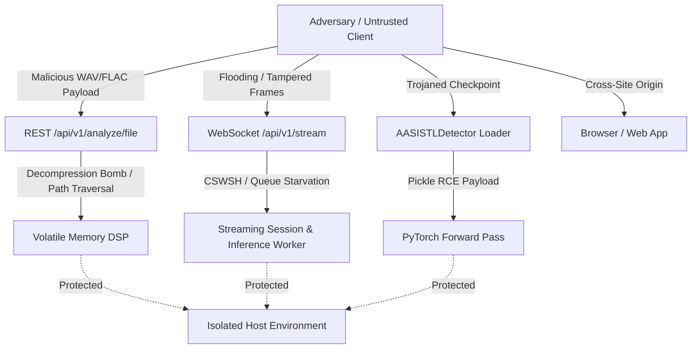

# VoiceShield Security, Privacy, and Threat Model Specification

**Classification**: Advisory Architecture Specification  
**Version**: `0.1.1`<br>
**Scope**: VoiceShield Core DSP Engine, Streaming Session Core, FastAPI Services, and Web Microphone Dashboard  
**Date**: October 2026  

---

## 1. Executive Summary & Core Principles

VoiceShield is designed as an **advisory acoustic deepfake detection engine**. Because synthetic voice technologies and acoustic monitoring inherently intersect with user privacy, sensitive biometric data, and adversarial threats, VoiceShield operates under four foundational principles:

1. **Volatile-Only Processing**: Voice recordings, raw PCM samples, and floating-point audio buffers are processed exclusively in volatile RAM and **never written to persistent disk storage** or logged.
2. **Defensive Model Isolation**: Untrusted checkpoints are protected by cryptographic SHA-256 integrity verification and restricted PyTorch deserialization (`weights_only=True`).
3. **Strict Resource Bounding**: Audio decompression, sliding-window queuing, WebSocket frame ingestion, and subprocess executions are bounded by hard ceilings to prevent Denial of Service (DoS) and memory exhaustion attacks.
4. **Transparent Advisory Scope**: VoiceShield explicitly states that acoustic anomaly scores do **not** prove caller identity, do **not** constitute legal proof of fraud, and do **not** guarantee 100% detection accuracy.

---

## 2. Threat Model

### 2.1 Assets to Protect

| Asset | Sensitivity | Protection Goal |
| :--- | :---: | :--- |
| **Host System & OS** | Critical | Prevent Remote Code Execution (RCE), command injection, and host compromise. |
| **System Resources (RAM/CPU/MPS)** | High | Prevent memory exhaustion, decompression bombs, and inference queue starvation. |
| **User Voice & Acoustic Privacy** | High | Guarantee zero unauthorized retention, zero voiceprint creation, and zero audio logging. |
| **Model Weight Integrity** | High | Prevent weight tampering, trojaned models, or unverified weight substitution. |
| **Advisory Decision Integrity** | Medium | Prevent cross-site WebSocket hijacking (CSWSH) and spoofed stream sessions. |

### 2.2 Threat Actors & Vectors



1. **Malicious Audio Uploaders**: Submitting crafted audio files containing path traversal sequences, decompression bombs (huge uncompressed durations), corrupt headers, or infinite values (NaN/Inf) to crash the server or exhaust unified memory.
2. **Adversarial Streaming Clients**: Establishing excessive WebSocket connections, sending oversized frames (> 128 KB), refusing to send data (idle connection starvation), or flooding the audio pipeline to create unbounded inference backlogs.
3. **Malicious / Compromised Weight Suppliers**: Distributing backdoored `.pth` checkpoints containing malicious Python pickle bytecode executing arbitrary commands upon `torch.load`.
4. **Cross-Site Attackers (CSWSH & CORS)**: Exploiting browser-based WebSocket connections from unauthorized third-party origins to hijack microphone sessions or extract anomaly evaluations.
5. **Adversarial Synthesizers**: Attackers crafting adversarial perturbations or novel generative architectures designed to evade AASIST-L acoustic feature representations.

---

## 3. Implemented Security & Privacy Controls

### 3.1 Unsafe Deserialization & Checkpoint Verification (CWE-502)

- **Control**: `torch.load(self.checkpoint_path, map_location="cpu", weights_only=True)`
- **Mechanism**: VoiceShield enforces `weights_only=True` on all PyTorch weight loading operations in `src/voiceshield/models/aasist_adapter.py`. This restricts the unpickler to tensors and primitive collections, completely neutralizing arbitrary Python code execution payloads embedded in malicious checkpoints.
- **Immutable Official Registry Verification**: Official model mode (`clovaai/aasist-l`) unconditionally computes the checkpoint SHA-256 before deserialization and matches it against the immutable registry entry:
  - **Expected SHA-256**: `814331d088032bb4c3fa61cc014789eadeed464209dd094ab3a2dd6ffbdce27a`
  - **Expected Size**: `426428` bytes
  - **Architecture Parameters**: `85306` parameters
  - **Pinned Upstream Commit**: `a04c9863f63d44471dde8a6abcb3b082b07cd1d1`
  - **Fail-Closed**: Any hash, size, or parameter divergence triggers immediate rejection (`CheckpointIntegrityError`) without invoking `torch.load`.
  - **Custom Model Identity**: Non-official checkpoints require setting `model_id: "custom/aasist-l"` and remain reported as `custom_unverified` with `checkpoint_verified = false`.
  - **Mock Mode**: Testing and UI demo mock mode (`mock/aasist-l`) is never official.

### 3.2 Audio Decompression & Memory Bomb Prevention (CWE-400)

- **Control**: Header inspection and bounded sample reading in `load_audio()`.
- **Mechanism**: In `src/voiceshield/dsp/preprocessor.py`:
  1. **Sampling Rate Boundaries**: Input sample rates are checked against `8000 <= orig_sr <= 192000`. Astronomical or non-positive rates are rejected immediately.
  2. **Header Duration Pre-Check**: Before allocating sample arrays, `sfile.frames / orig_sr` is calculated. If the declared duration exceeds `max_duration_seconds` (e.g. 300.0s for uploads), the file is rejected with `UnsupportedAudioError` before decoding samples into RAM.
  3. **Bounded Reading**: During decoding, `sfile.read()` reads at most `int(orig_sr * (max_duration_seconds + 1.0))` frames. This prevents crafted compressed files (e.g., FLAC zip-bombs) from consuming hundreds of megabytes of RAM.

### 3.3 FFmpeg Subprocess Elimination & Libsndfile Safety

- **Architectural Decision**: VoiceShield **does not invoke FFmpeg via subprocess**.
- **Rationale**:
  - Eliminating `subprocess.run(["ffmpeg", ...])` removes entire classes of command-injection, shell-expansion, argument-injection, and zombie-subprocess vulnerabilities.
  - Audio decoding is performed strictly in-process using `libsndfile` via Python `soundfile` bindings.
  - Allowed container formats are locked to `("WAV", "FLAC")`. All other container formats (e.g. MP4, AVI, MKV, OGG) are rejected at the header boundary.

### 3.4 Subprocess Execution Hardening (CWE-78, CWE-400)

- **Control**: Strict argument arrays, `shell=False`, and mandatory execution timeouts.
- **Mechanism**: In `src/voiceshield/reproducibility/metadata.py` and `src/voiceshield/benchmark/runner.py`, system queries (`git rev-parse`, `git status`, `sysctl -n`) are strictly executed with:
  - Fixed argument lists (`subprocess.run(["sysctl", "-n", key], ...)`).
  - Explicit timeouts: `timeout=5.0`.
  - Suppressed shell execution (`shell=False`).
  - No user-controlled parameters passed to shell executables.

### 3.5 Path Traversal & Filename Sanitization (CWE-22)

- **Control**: URL-decoding, control character removal, and basename restriction.
- **Mechanism**: In `services/api/routes/analyze_file.py::sanitize_filename()`:
  1. `urllib.parse.unquote()` is executed first to prevent double-encoding bypasses (e.g., `%2e%2e%2f` -> `../`).
  2. Null bytes (`\x00`) and ASCII control characters (`\x01-\x1f\x7f-\x9f`, newlines, carriage returns) are stripped.
  3. Windows backslashes are normalized to forward slashes.
  4. Path traversal sequences (`..`) and directory hierarchies are stripped via `Path.name` and regex scrubbing.
  5. Fallback defaults to `uploaded_audio.wav` if the resulting filename is empty.

### 3.6 WebSocket Streaming Security & Session Lifecycle

- **Origin Verification**: Every incoming WebSocket connection checks the HTTP `Origin` header against `VOICESHIELD_CORS_ORIGINS`. Disallowed cross-site origins are rejected before handshake acceptance (`WS_1008_POLICY_VIOLATION`).
- **Atomic Session Admission (Audit M-03)**:
  - Streaming slots are reserved atomically via `AtomicAdmissionController` *before* `websocket.accept()`, handshake wait, or `StreamingSession` construction.
  - Handshaking connections count against the session ceiling (`reserved_count` reflects handshaking + active streams).
  - Maximum concurrent streaming sessions are guarded by `VOICESHIELD_MAX_CONCURRENT_SESSIONS` (default: 10). Excess sessions receive a structured `CONCURRENCY_LIMIT_REACHED` error with code 1008 without entering handshake wait.
  - Every reservation is released exactly once in `finally:` blocks across all error, timeout, and cancellation paths.
- **Client Metadata Ceilings (Audit M-03)**:
  - Client handshake metadata can only *tighten* (lower) server-owned ceilings; metadata can **never** raise server ceilings.
  - Server Defaults: `MAX_FRAME_BYTES_DEFAULT` (128 KB = 131,072 bytes), `MAX_STREAM_DURATION_SECONDS_DEFAULT` (3,600.0s = 1 hour), `DEFAULT_IDLE_TIMEOUT_SECONDS` (30.0s).
  - Lower Bounds: `max_frame_bytes >= 1024`, `max_stream_duration >= 1.0s`, `idle_timeout >= 0.1s`.
  - Non-numeric, boolean, NaN, and ±Infinity metadata values are safely rejected and fall back to server defaults.
- **Sampling Rate Limits**: Ingested audio must conform to the inclusive range `8,000 Hz <= sample_rate <= 192,000 Hz`. Out-of-bounds rates are rejected with `UnsupportedAudioError`.
- **Explicit Little-Endian PCM Contract**: Streaming frames accept little-endian encodings: 16-bit signed integer (`<i2`), 32-bit signed integer (`<i4`), and 32-bit floating point (`<f4`).
- **Byte and Interleaved-Frame Alignment**: Byte buffers must be strictly divisible by the sample width (2 bytes for int16, 4 bytes for int32/float32) and complete frame width (`bytes_per_sample * channels`). Partial samples or incomplete interleaved channel frames are rejected with `AudioDecodingError` (subclass of `CorruptAudioError`).
- **Finite Float32 and Domain Validation**: Decoded floating-point samples are verified for finiteness (rejecting NaN, +Inf, -Inf) and bounded to the amplitude range `[-1.0, 1.0]`. Out-of-bounds values raise `InvalidAudioValueError`.
- **Validation-Before-State-Mutation Guarantee**: Complete input validation (encoding, sample rate, channels, byte alignment, complete frame alignment, finiteness, amplitude range, and non-empty count) is executed strictly before mutating any session state. A malformed frame sets an input-error diagnostic flag but does NOT mutate accepted audio in the ring buffer, timestamps (`_last_frame_timestamp`, `_expected_next_timestamp`), declared stream format, continuity segment IDs, resampler state, VAD state, or temporal policy history. Format locking occurs only upon the first successfully validated and accepted frame.
- **Recoverable Audio Decode Errors**: When a client transmits a malformed or misaligned frame, the WebSocket connection remains open, logs an advisory warning, and transmits an `AUDIO_DECODE_ERROR` event to the client. The session preserves all prior accepted audio and expected timestamps, allowing immediate resumption of contiguous streaming without false continuity resets.
- **Deterministic Cleanup & VAD Reset**: Session teardown (`finally:` block) guarantees cancellation of in-flight inference tasks, circular buffer memory reset (`session.reset()`), invocation of the `BaseVAD.reset()` hook, and removal from active session registries.

### 3.7 Inference Denial of Service (DoS), Queue Starvation & Stale Drop Accounting

- **Process-Wide Single-Worker Inference Execution**:
  A dedicated single-worker execution service (`InferenceWorker`, backed by a lifecycle-owned `ThreadPoolExecutor(max_workers=1)`) guarantees that exactly one synchronous inference callable executes at a time across both streaming WebSocket and offline file-analysis routes.
  - **Cancellation Safety (Audit H-04)**: In Python, cancelling an awaiting coroutine does not terminate the underlying physical thread. Unlike cancellation-sensitive semaphores that release capacity upon caller cancellation while the detector thread is still executing, `InferenceWorker` tracks the physical `concurrent.futures.Future`. If a client disconnects or an HTTP request is cancelled while inference is physically running, the worker remains occupied until the physical callable returns, and subsequent jobs remain queued without overlapping.
  - **Detached Result Abandonment**: Results from disconnected sessions are safely abandoned: they do not mutate the reset `StreamingSession`, update temporal policy, emit events, or launch pending windows. Any exception raised by an abandoned job is consumed and logged without unhandled future warnings.
  - **Graceful Stop vs. Abrupt Disconnect**: Graceful stop (`stop` command) waits for active and pending inference jobs to drain before emitting `session_stopped`. Abrupt disconnect cancels awaiting coroutines, gathers unwinding tasks, resets session resources, and disconnects immediately, while physical model execution finishes cleanly in the background.
  - **Bounded Shutdown**: Lifespan shutdown stops new job intake, cancels unstarted queued jobs, and awaits physically executing jobs up to a bounded timeout. Python cannot forcibly kill a running detector thread; if the timeout expires, an error is logged and the unresolved state is reported honestly rather than claiming forced termination.
- **Bounded Streaming Queue Depth**: The streaming session enforces an O(1) bounded queue:
  - At most **one** window is in flight for model inference (`_in_flight_window`).
  - At most **one** fresher eligible window is held in the pending slot (`_pending_window`).
  - If a newer window arrives while inference is in flight, it **replaces** the older pending window rather than growing an unbounded queue. Replaced pending windows are immediately counted in `total_windows_dropped` and `windows_dropped_this_ingest`.
- **Continuity Resets & Stale In-Flight Drop Accounting**: When a timing gap or discontinuity occurs (delta > threshold or out-of-order timestamps):
  - Ring buffers, stateful resamplers, temporal policy state, and VAD state (`session.vad.reset()`) are reset, and the continuity segment ID increments.
  - Any stale in-flight window currently executing on the model worker is accounted for immediately at continuity reset time: `total_windows_dropped` and `windows_dropped_this_ingest` increment by 1, and the updated drop total is immediately reported in the WebSocket quality event.
  - When the stale inference call eventually completes, its score and decision are suppressed (`complete_inference` returns `None`), no score is recorded in temporal history, and the drop counter is **not** incremented a second time.
  - A fresh post-gap pending window is immediately dispatched once the worker finishes.

### 3.8 Audio Privacy & Ephemeral Spooling Lifecycle

- **No Long-Term Audio Retention**: Raw PCM audio bytes received over REST or WebSocket are never intentionally persisted after request cleanup. No audio frames are saved to databases, permanent disks, or cloud storage.
- **Starlette UploadFile Spooling Behavior**:
  Starlette's `UploadFile` utilizes Python's standard library `tempfile.SpooledTemporaryFile(max_size=1048576)` (1 MB). Uploads up to 1 MB remain strictly in volatile memory buffers. When a multipart upload exceeds 1 MB, the OS spools the stream into an ephemeral temporary file on the host filesystem. Upon request completion, FastAPI's background cleanup closes and deletes the temporary file automatically. VoiceShield reads the accepted file stream into a bounded in-memory buffer (`io.BytesIO`) for evaluation and does not retain the temporary file.
- **No Residual Logging**: Log messages across `services/api/` and `src/voiceshield/` record only session IDs, sampling rates, window counts, and timing statistics. **No audio samples, transcripts, spoken words, or personally identifiable data are ever logged.**
- **Automatic Browser Cleanup**: The React dashboard uses `AudioWorklet` with zero browser-side caching or IndexedDB storage. Upon stopping or unmounting, all tracks on `MediaStream` are explicitly stopped (`track.stop()`), and `AudioContext` and `WebSocket` connections are closed.

### 3.9 CORS Configuration Hardening

- **Control**: Automatic credential restriction on wildcard origin.
- **Mechanism**: In `services/api/main.py`, if `VOICESHIELD_CORS_ORIGINS` contains `*`, `allow_credentials` is automatically set to `False` to prevent browser CORS violations and credential leakage risks.

### 3.10 Pre-Parsing File-Upload Admission & Request-Body Ceiling (Audit M-03)

- **Pre-Parsing ASGI Middleware**:
  FastAPI's default multipart parsing buffers/spools request bodies *before* endpoint handler execution. To prevent unmetered memory/disk consumption by concurrent uploads, VoiceShield intercepts `POST /api/v1/analyze/file` in pure ASGI middleware (`FileUploadAdmissionMiddleware`) *before* body consumption or multipart parsing begins.
- **Upload Concurrency Guard**:
  Regulated by `AtomicAdmissionController` with limit `VOICESHIELD_MAX_CONCURRENT_FILE_UPLOADS` (positive integer, default: 2). Requests arriving when admission is saturated are rejected immediately with HTTP 429 (`FILE_UPLOAD_CONCURRENCY_LIMIT_REACHED`, `Retry-After: 5`, `Connection: close`) without reading or spooling the request body.
- **Two-Layer Total Request-Body Ceiling**:
  Total request body size and individual audio file size are bounded separately:
  - Individual Audio File Limit: `MAX_FILE_BYTES = 25 MB` (26,214,400 bytes), enforced within the route handler.
  - Multipart Protocol Overhead: `MAX_UPLOAD_REQUEST_OVERHEAD_BYTES = 1 MB` (1,048,576 bytes).
  - Total Request Body Ceiling: `MAX_UPLOAD_REQUEST_BYTES = 26 MB` (27,262,976 bytes).
  Enforced in two defensive layers:
  1. **Layer A (Content-Length Precheck)**: If a declared `Content-Length` header exceeds 26 MB, the request is immediately rejected with HTTP 413 `PAYLOAD_TOO_LARGE` without reading any request body bytes.
  2. **Layer B (Streaming Receive Counter)**: For chunked transfer encoding, missing length headers, or false headers, the ASGI `receive` callable is wrapped with a byte counter. As chunks arrive, the cumulative size is tracked. If the total exceeds 26 MB, reception terminates immediately and a structured HTTP 413 `PAYLOAD_TOO_LARGE` error is returned.

### 3.11 Recommended Deployment & Reverse-Proxy Hardening

While VoiceShield implements strict application-level resource bounding, application defenses **do not replace** edge security, TLS termination, user authentication, or reverse-proxy protection for public internet deployments. Production deployments must place VoiceShield behind a hardened reverse proxy (e.g., Nginx, Caddy, Cloudflare, AWS ALB) configured with:

1. **Request Body Limits**: Match the application total body ceiling (e.g. `client_max_body_size 26m;` in Nginx) to drop oversized attacks before forwarding to the application process.
2. **Connection & Rate Limiting**: Enforce IP-level connection limits (`limit_conn`) and request rate limits (`limit_req`) on `/api/v1/analyze/file` and `/api/v1/stream`.
3. **Read / Idle Timeouts**: Configure proxy read and idle timeouts no greater than the application ceiling (e.g. `proxy_read_timeout 30s;`).
4. **TLS Termination & Authentication**: Enforce HTTPS (`wss://` and `https://`) with modern cipher suites and integrate mutual TLS or API token authentication at the proxy layer.
5. **Host Hardening**: Run the API process in an unprivileged container or sandbox with strict memory and CPU cgroups.

---

## 4. Residual Risks

Despite the defensive controls implemented above, the following residual risks remain outside the software's direct architectural control:

1. **Adversarial Acoustic Perturbations**: Deepfake generators can introduce imperceptible high-frequency noise or vocoder artifacts designed to evade the AASIST-L graph architecture. VoiceShield outputs must always be interpreted as advisory evidence, not proof.
2. **Local Machine & Kernel Compromise**: If the host machine running VoiceShield is compromised at the root or operating system level, memory scraping could access volatile audio buffers while inference is running. Host hardening (FileVault, SIP, sandboxing) is required.
3. **Physical Microphone Eavesdropping**: The browser dashboard relies on the operating system's microphone privacy indicators. If the host machine has malicious hardware or driver-level keyloggers/wiretaps, audio could be intercepted before reaching the browser.
4. **Zero-Day Acoustic Generators**: AASIST-L was trained on known generator families. Unseen, novel neural voice synthesis methods may exhibit higher false-negative rates until the detector is retrained or updated.

---

## 5. Incident Response & Rollback Procedures

### 5.1 Incident Response Plan

In the event of a suspected security vulnerability, unexpected data exposure, or model integrity failure:

1. **Immediate Service Isolation**:
   ```bash
   # Terminate active API servers
   pkill -f "uvicorn services.api.main:app"
   ```
2. **Audit Checkpoint Integrity**:
   Verify the SHA-256 hash of the on-disk weights file:
   ```bash
   shasum -a 256 models/weights/AASIST-L.pth
   ```
   Compare against the published upstream Clova AI / HuggingFace hash.
3. **Inspect Active Origin Policy**:
   Verify that `VOICESHIELD_CORS_ORIGINS` is not set to `*` in production environments.
4. **Rotate Infrastructure Credentials**:
   If deployed behind a reverse proxy (e.g. Nginx, Caddy), rotate SSL/TLS certificates and API tokens.

### 5.2 Rollback Procedure

If a deployed update or checkpoint exhibits behavioral instability or regression:

1. **Revert to Previous Git Release**:
   ```bash
   git checkout tags/v0.1.0
   ```
2. **Re-run Security Parity Suite**:
   ```bash
   .venv/bin/pytest tests/test_security_privacy.py -v
   ```
3. **Restart Service in Safe Mode**:
   ```bash
   VOICESHIELD_DEVICE=cpu make api
   ```

---

## 6. Legal, Regulatory, and Compliance Review Notice

> [!WARNING]
> **Legal Disclaimer & Review Requirement**  
> VoiceShield and this document **do not constitute legal advice** and do **not certify compliance** with any municipal, state, federal, or international wiretapping, biometric privacy, or artificial intelligence regulations.  
> Deploying synthetic voice detection technologies in production requires independent formal review by qualified legal counsel.

Organizations deploying VoiceShield must obtain legal review regarding:

1. **Wiretapping and Recording Consent**:
   - In jurisdictions requiring **all-party consent** (e.g., California, Florida, Massachusetts, Germany), capturing or routing live telephone or microphone audio through automated analysis tools may require explicit affirmative consent from all speakers.
   - VoiceShield provides visual and audible consent status banners in the UI, but technical indicators do not replace legal consent workflows.
2. **Biometric Privacy Laws**:
   - Statutes such as the **Illinois Biometric Information Privacy Act (BIPA)**, **Texas Capture or Use of Biometric Identifier Act (CUBI)**, and **California Consumer Privacy Act / CPRA** govern the collection of voiceprints.
   - While VoiceShield extracts acoustic spectral/graph anomaly representations rather than biometric identification voiceprints, legal definitions of "biometric identifier" vary by jurisdiction.
3. **General Data Protection Regulation (GDPR) / UK GDPR**:
   - Processing human voice recordings may constitute personal data under Article 4(1) and special category biometric data under Article 9. Deployers must establish an appropriate Article 6 lawful basis and maintain Data Protection Impact Assessments (DPIA).
4. **AI Safety and Synthetic Media Disclosures**:
   - The **EU Artificial Intelligence Act (EU AI Act)** and US Federal Executive Orders impose transparency requirements on AI systems that generate, process, or detect synthetic media.
   - VoiceShield strictly labels detections as advisory anomaly assessments to prevent deceptive claims of certainty.
