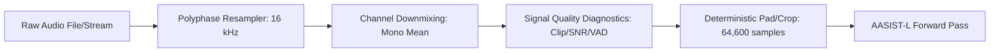
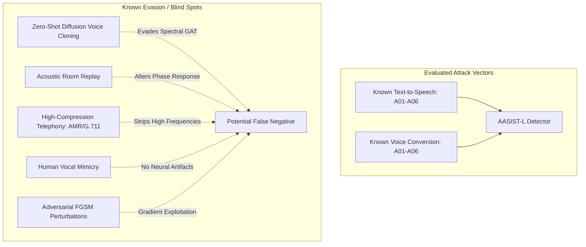

# VoiceShield Model Card: AASIST-L (Integrated Spectro-Temporal Graph Attention Network)

**Model Identifier**: `VoiceShield-AASIST-L-v0.1.0`  
**Base Architecture**: AASIST-L (Lightweight Audio Anti-Spoofing using Integrated Spectro-Temporal Graph Attention Networks)  
**Upstream Provenance**: Clova AI Research / NAVER Corp & University of Seoul (Jung et al., ICASSP 2022)  
**Upstream Repository**: [`https://github.com/clovaai/aasist`](https://github.com/clovaai/aasist) (Pinned commit: `a04c9863f63d44471dde8a6abcb3b082b07cd1d1`)  
**License boundary**: Original VoiceShield code is Apache-2.0; vendored upstream AASIST source is MIT; the AASIST-L checkpoint and referenced datasets are governed by separate terms.
**Model Type**: Binary Acoustic Anti-Spoofing / Synthetic Speech Detector  
**Card Version**: `1.0.0` (Truthful Baseline)  
**Date**: October 2026  

---

## 1. Model Overview & Architecture

AASIST-L is an end-to-end deep neural network designed to discriminate authentic human speech (*bona fide*) from synthesized (*TTS*), voice-converted (*VC*), or computer-generated acoustic deepfakes directly from raw waveforms without lossy time-frequency hand-crafted representations.

### 1.1 Structural Specification

| Architectural Component | Specification | Technical Rationale |
| :--- | :--- | :--- |
| **Input Signal** | Raw 1D Audio Waveform | Bypasses fixed STFT/MFCC representations to preserve phase anomalies. |
| **Input Length (`nb_samp`)** | 64,600 samples ($4.0375\text{ s}$ @ $16\text{ kHz}$) | Standard evaluation context window capturing phonemic transitions. |
| **Front-End Feature Extractor** | SincNet (128 Mel-bandpass filter kernels) | Parameterized bandpass filters learning sub-band spectral boundaries. |
| **Spectral Encoder** | Residual Blocks (`[70, [1, 32], [32, 32], [32, 24], [24, 24]]`) | Squeeze-and-Excitation 2D convolutions over spectro-temporal maps. |
| **Graph Module** | Heterogeneous Spectro-Temporal Graph Attention (GAT) | Models long-range non-local relationships across frequency and time nodes. |
| **Graph Dimensions (`gat_dims`)** | `[24, 32]` | Lightweight latent node projection. |
| **Node Pooling (`pool_ratios`)** | `[0.4, 0.5, 0.7, 0.5]` | Top-$k$ hierarchical graph pooling. |
| **Output Layer** | 2 linear projection logits (`spoof: 0`, `bonafide: 1`) | Binary hypothesis decision space. |
| **Total Parameters** | **85,306 parameters** | Ultra-compact footprint optimized for local M3 edge execution. |

---

## 2. Preprocessing & Input Contract

VoiceShield enforces a strict, deterministic preprocessing contract prior to model ingestion:

1. **Sampling Rate**: Strictly $16,000\text{ Hz}$. Non-matching rates are converted via Kaiser-windowed polyphase sinc resampling.
2. **Channel Downmix**: Multi-channel audio (up to 8 channels) is downmixed to mono via arithmetic mean in float32: $x_{\text{mono}} = \frac{1}{C} \sum_{c=1}^C x_c$.
3. **Amplitude Normalization**: Peak-normalized to $[-1.0, 1.0]$ if peak exceeds 1.0. Infinite (Inf) or NaN values are rejected immediately.
4. **Deterministic Evaluation Framing (`pad_for_aasist`)**:
   - Audio shorter than $64,600$ samples: Cyclically tiled until reaching $64,600$ samples.
   - Audio longer than $64,600$ samples: Truncated to the leading $64,600$ samples.
   - Zero silence padding, no random cropping, and no stochastic augmentations during inference.

---

## 3. Training & Adaptation Data

VoiceShield uses the official pre-trained AASIST-L baseline trained by NAVER Clova AI on the **ASVspoof 2019 Logical Access (LA)** training split:

### 3.1 Data Categories & Provenance

| Split | Utterances | Bona Fide Speakers | Generators Included | Licensing & Distribution |
| :--- | :---: | :---: | :--- | :--- |
| **ASVspoof 2019 LA Train** | 25,380 | 20 (8 M, 12 F) | A01–A06 (Neural & vocoder TTS / VC) | Academic / Research Use Only (Interspeech Consortium) |
| **ASVspoof 2019 LA Dev** | 24,844 | 20 (8 M, 12 F) | A01–A06 (Known in-set generators) | Academic / Research Use Only (Interspeech Consortium) |
| **VoiceShield Adaptation** | **None** | N/A | **Not yet adapted** | Frozen upstream weights; no fine-tuning applied. |

- **Zero Speaker Leakage**: Training, development, and evaluation partitions in ASVspoof 2019 LA are strictly speaker-disjoint.
- **Generator Holdout**: Evaluation split contains unseen synthetic speech generators (A07–A19) not present in the training set.

---

## 4. Intended Use & Prohibited / Misleading Uses

### 4.1 Permitted & Intended Uses

- **Advisory Risk Indicator**: Real-time signal intelligence providing risk advisory flags during incoming VoIP or cellular calls.
- **Offline Batch Auditing**: Scanning archived customer service or verification recordings for potential neural audio synthesis artifacts.
- **Defense-in-Depth Telephony Screening**: A preliminary layer in a multi-factor verification pipeline that prompts human agents to execute independent out-of-band verification.

### 4.2 Prohibited & Misleading Uses

> [!CAUTION]
> **Strict Operational Prohibition**  
> VoiceShield is an **acoustic anomaly detector**, not a biometric identity verifier. Any deployment that violates the following prohibitions is unsupported and considered a dangerous misuse of the technology.

1. **NO Identity Proof**: VoiceShield outputs do **NOT** prove or disprove caller identity. A real human speaker using a genuine phone can still be an unauthorized imposter, fraudster, or coerced victim.
2. **NO Autonomous Call Blocking**: Systems must **never** automatically terminate phone calls, freeze bank accounts, or deny emergency services based solely on VoiceShield scores.
3. **NO Claim of 100% Detection**: Never pitch or document VoiceShield as "flawless", "unhackable", or "100% deepfake prevention".
4. **NO Legal Proof of Fraud**: VoiceShield scores are statistical likelihoods and do not constitute admissible forensic proof of criminal fraud without specialized expert witness corroboration.
5. **NO Biometric Voiceprinting**: The system must not be used to build biometric speaker recognition profiles or track individual voices across calls.

---

## 5. Threat Model & Adversarial Environment

VoiceShield operates in an adversarial environment where generative models continuously evolve. The threat model recognizes that:
1. Attackers have access to state-of-the-art open-source zero-shot voice cloning tools (e.g. F5-TTS, CosyVoice, XTTSv2, StyleTTS2).
2. Attackers can route synthesized audio through physical speakers, microphones, and low-bitrate VoIP codecs to mask synthesis artifacts.
3. Attackers can inject gradient-based adversarial perturbations directly into raw PCM buffers.

---

## 6. Known Limitations & Technical Failure Modes

| Failure Mode | Impact on Model | Engineering Mitigation |
| :--- | :--- | :--- |
| **Unseen Generative Models** | Generative models with modern neural vocoders (HiFi-GAN, BigVGAN) or diffusion backbones exhibit higher false negative rates than older training sets (A01–A06). | Temporal hysteresis policy requires sustained elevation across windows before raising alarms. |
| **Telephony Codec Transcoding** | Low-bitrate codecs (AMR 4.75 kbps, G.711 A-law, Opus 8 kbps) discard spectral content above $3.4\text{ kHz}$ or introduce quantization noise, altering graph node features. | Audio contract validates signal quality and flags bandlimited conditions. |
| **Acoustic Replay** | Replaying authentic audio through low-quality loudspeakers introduces physical room reverberation rather than neural synthesis signatures. | AASIST-L is trained primarily on logical access (LA) artifacts, not physical access (PA) replay. Replay detection is unverified. |
| **Background Noise & Crosstalk** | Multi-speaker crosstalk or street noise corrupts the SincNet filterbank representation, leading to false positives. | Energy-based VAD gates out non-speech segments ($\ge 0.8\text{ s}$ speech required per 4.0s window). |
| **Human Impersonation & Mimics** | Human voice actors mimicking another person's cadence produce bona fide acoustic waveforms. | AASIST-L detects neural synthesis artifacts, not behavioral imitation; mimics will correctly score as bona fide. |
| **Short Utterances ($< 1.0\text{ s}$)** | Utterances with insufficient speech duration do not contain enough phonemic transitions for reliable graph attention. | Temporal policy issues an immediate `INSUFFICIENT_SPEECH_DURATION` abstention rather than guessing. |

---

## 7. Calibration & Threshold Provenance

- **Scoring Formulation**:
  AASIST-L produces linear logits $(\text{logit}_0, \text{logit}_1)$ where index 0 is spoof and index 1 is bona fide. The uncalibrated synthetic anomaly score is:
  $$\text{score}_{\text{synthetic}} = \sigma(\text{logit}_0 - \text{logit}_1) = \frac{1}{1 + e^{-(\text{logit}_0 - \text{logit}_1)}}$$
  This raw softmax output is an **uncalibrated acoustic anomaly score**, NOT a calibrated probability.
- **Default Operating Threshold**: **`0.65`** (`operating_threshold_source: "unvalidated_heuristic"`).
  - Selected heuristically as an unvalidated starting threshold for initial pipeline integration. It has not been calibrated or empirically optimized on an operational validation split.
- **Probabilistic Calibration Status**: **Uncalibrated**.
  - No empirical temperature scaling, Platt scaling, or isotonic calibration has been fitted to local target partitions.
  - Runtime APIs output `calibrated_score: null` and `score_is_calibrated: false` until an empirically fitted calibrator is loaded. Decision reason details report *"Low acoustic anomaly score — does not authenticate speech"* when scores are low.

---

## 8. Latency & Hardware Profile (Apple MacBook Pro M3)

The official checkpoint was measured using the VoiceShield Benchmark Suite on
an Apple MacBook Pro M3. These are engineering latency and throughput
measurements, not detection-performance evidence.

- **Host Device**: Apple MacBook Pro M3.
- **Benchmark commit**: `392ca34eaf76eecf4afd8d23ca5049f39eec08f5`.
- **Checkpoint SHA-256**:
  `814331d088032bb4c3fa61cc014789eadeed464209dd094ab3a2dd6ffbdce27a`.
- **Benchmark Report Artefact**: [`reports/benchmarks/m3_benchmark_report.md`](../reports/benchmarks/m3_benchmark_report.md).

| Stage | Device | Warm-up mean | Steady p50 | Steady p95 | Steady p99 | Throughput | RTF | Target (<200ms) |
| :--- | :---: | ---: | ---: | ---: | ---: | ---: | ---: | :---: |
| **Stage 1: Decoding/Resampling** | CPU | 18.117 ms | 6.257 ms | 8.716 ms | 14.713 ms | 139.94 win/s | 0.00156 | N/A |
| **Stage 2: Feature Extraction/Padding** | CPU | 0.097 ms | 0.052 ms | 0.054 ms | 0.057 ms | 19,972.38 win/s | 0.00001 | N/A |
| **Stage 3: Model Inference** | CPU | 164.333 ms | **112.999 ms** | **129.814 ms** | 181.354 ms | 8.45 win/s | **0.02825** | ✅ MET |
| **Stage 3: Model Inference** | **MPS (Metal)** | 70.577 ms | **30.187 ms** | **30.761 ms** | 34.043 ms | **32.91 win/s** | **0.00755** | **✅ MET** |
| **Stage 4: Score Smoothing & Temporal Policy** | CPU | 0.019 ms | 0.004 ms | 0.004 ms | 0.005 ms | 263,941.37 win/s | 0.0 | N/A |
| **Stage 5: End-to-End Window** | CPU | 112.668 ms | **111.981 ms** | **117.614 ms** | 125.402 ms | 8.83 win/s | **0.02800** | ✅ MET |
| **Stage 5: End-to-End Window** | **MPS (Metal)** | 34.418 ms | **33.754 ms** | **34.546 ms** | 37.079 ms | **29.44 win/s** | **0.00844** | **✅ MET** |

The MPS end-to-end measurement was 3.32x faster than CPU. The benchmark used
10 warmups and 100 steady-state iterations. It does not establish local EER,
accuracy, min-tDCF, calibration, or generalization.

---

## 9. Privacy, Retention & Governance

1. **Volatile-Only Memory Processing**: Audio ingested via streaming WebSocket or file upload is processed strictly in volatile RAM (`io.BytesIO`, `AudioRingBuffer`). **No audio is written to disk.**
2. **Zero Audio Logging**: System logging records only session identifiers, window counts, quality flags, and latency statistics. Audio waveforms, phonemes, and transcripts are never logged.
3. **No Biometric Identification**: The model has no capability to recognize individual speakers, matching voices against a gallery, or storing speaker fingerprints.
4. **Client-Side Microphone Control**: The React frontend captures audio via `AudioWorklet` with explicit user consent gesture, and immediately stops all browser media tracks (`track.stop()`) on disconnection.

---

## 10. Versioning & Rollback

- **Model Checkpoint Pinning**: Fixed path `models/weights/AASIST-L.pth`.
- **Integrity Gate**: In official mode (`clovaai/aasist-l`), VoiceShield enforces automatic SHA-256 verification against the central immutable registry (`814331d088032bb4c3fa61cc014789eadeed464209dd094ab3a2dd6ffbdce27a`, size 426428 bytes, 85306 parameters) before `torch.load` and fails closed on any mismatch. Custom weights require explicit `custom/aasist-l` identity. Mock mode (`mock/aasist-l`) is never official.
- **Rollback Procedure**: In the event of model regression or unhandled PyTorch MPS operator incompatibility, execution automatically falls back to CPU (`metadata["fallback_used"] = True`).
